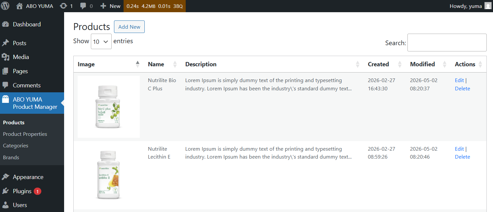
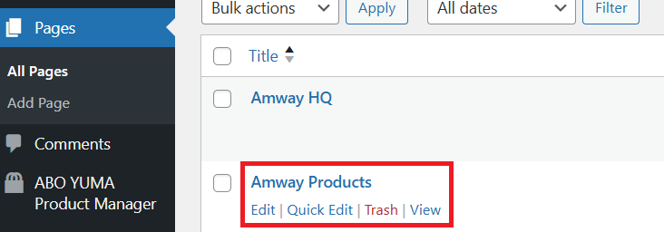
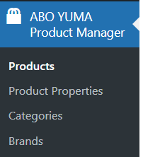
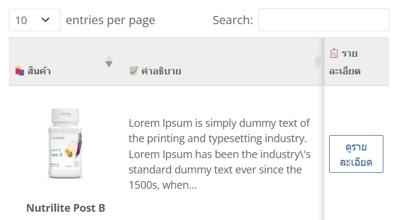
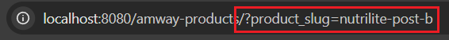

# ABO YUMA Product Manager

A custom WordPress product manager plugin built on top of the [WordPress Plugin Boilerplate](https://github.com/DevinVinson/WordPress-Plugin-Boilerplate).  
This plugin is intended to present product information and reviews in a structured, user-friendly format for customers.

  

It is specifically designed for Amway products and built exclusively for use with the **ABO YUMA theme**.  

The plugin automatically registers product page.

  

## 📦 Admin Modules

  

- Products (CRUD)
- Product Properties (CRUD)
- Categories (CRUD)
- Brands (CRUD)

### Workflow

1. Create **Categories**, **Brands**, and **Product Properties**
2. Create **Products** and assign the above data

## 🌐 Public-Facing Features

  

- Product listing with jQuery DataTables
- Dynamic product detail page
- Image gallery with Lightbox support
- Basic SEO optimization for product detail pages
  - Dynamic `<title>` tag based on product name
  - Dynamic `<meta name="description">`
  - Canonical URL to prevent duplicate content issues
  - Suppression of default page title for virtual detail views

## 🔁 Public-facing page routing
The plugin implements a virtual page routing mechanism using WordPress query variables and content filtering.

 

## ⚙️ Installation

1. Place the plugin folder inside `wp-content/plugins/` directory.
2. Activate the plugin through the Plugins screen (Plugins > Installed Plugins).

## 🎨 Theme Compatibility

Optimized for the ABO YUMA theme with Bootstrap 5 and dark mode support.

This plugin requires [Bootstrap 5](https://getbootstrap.com/) and [jQuery DataTables (Bootstrap 5 integration)](https://datatables.net/examples/styling/bootstrap5).  
It does not bundle these dependencies.

> ⚠️ Known limitation: This plugin is optimized for the ABO YUMA theme.  
> When used with other Bootstrap-based themes, layout issues may occur.  
> Compatibility improvements are planned for future updates.

## 📌 TODO

- Integrate PHP CodeSniffer (PHPCS) for automated code quality checks
- Gradually align the codebase with WordPress PHP Coding Standards (WPCS)
- Refactor and improve Admin modules for better maintainability
- Improve form validation with client-side JavaScript validation
- Improve inline code comments and documentation for better maintainability
